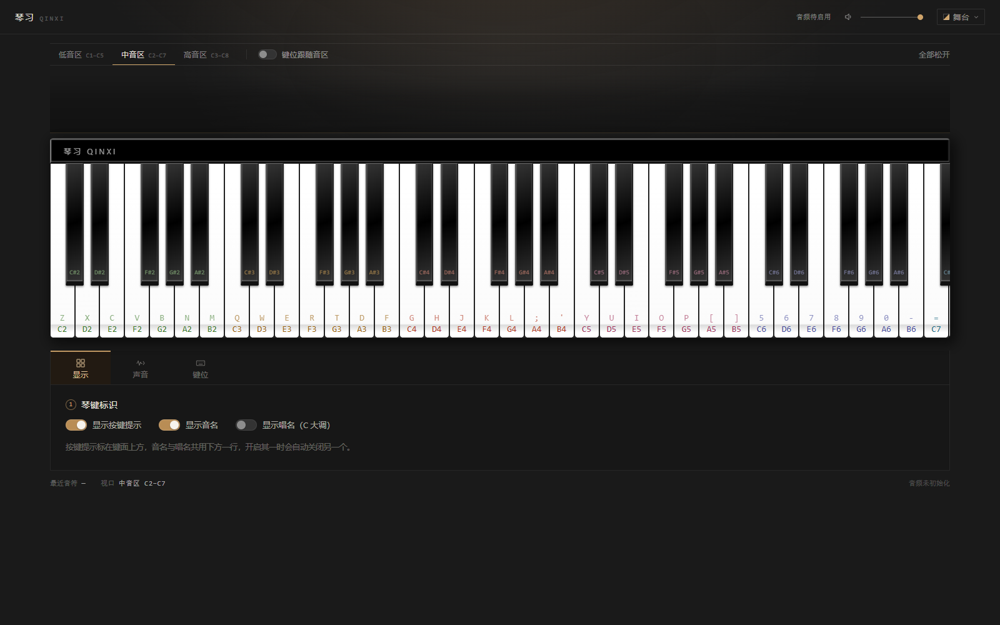
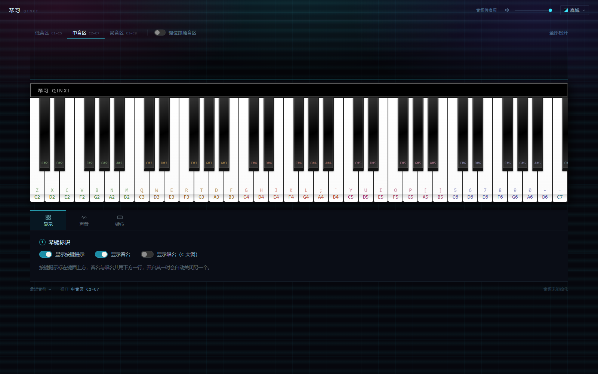
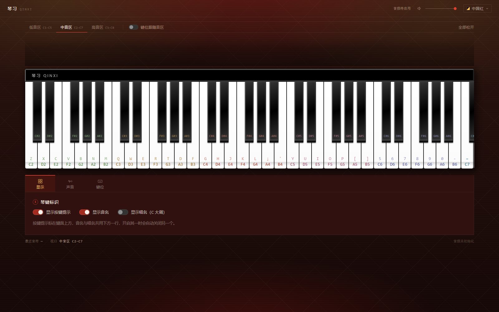
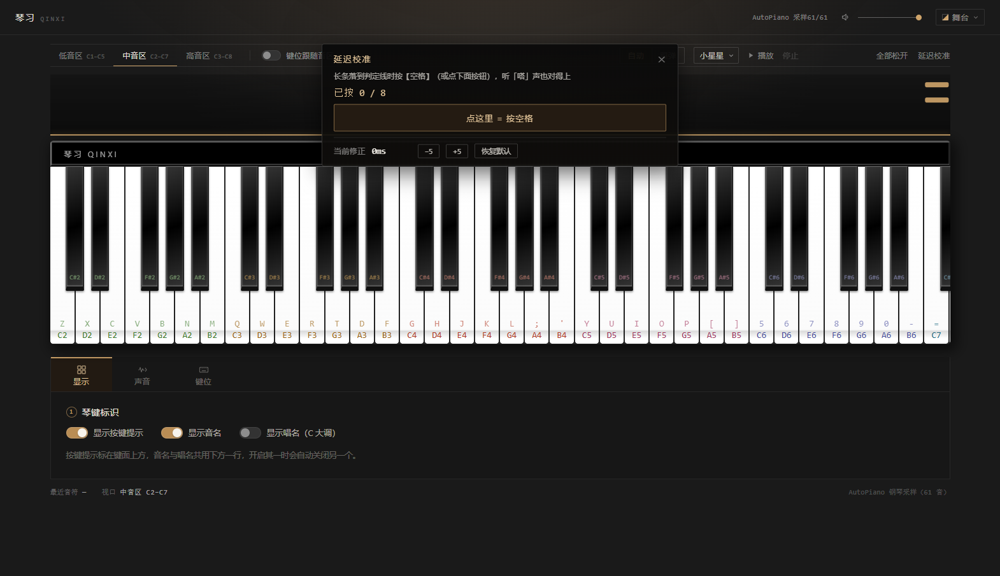
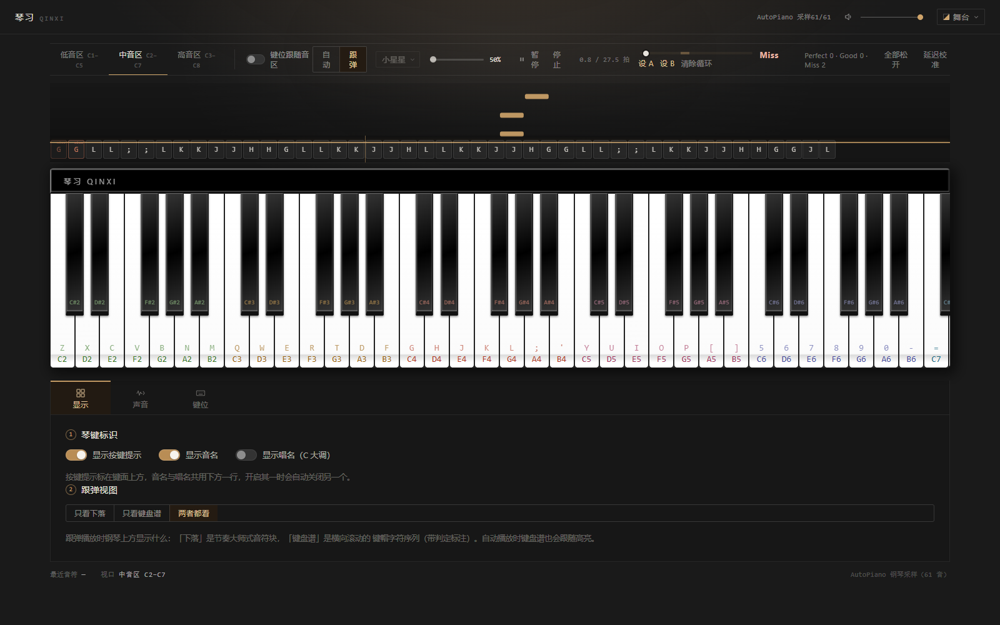
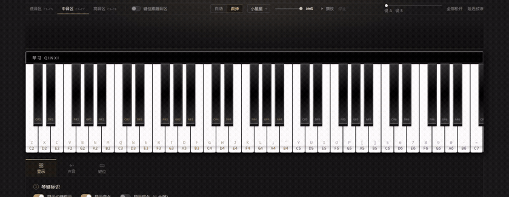
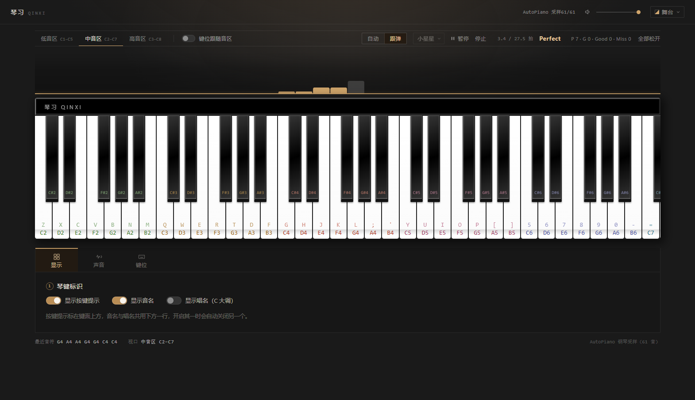
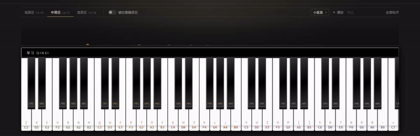

# 琴习 QinXi

在浏览器里弹钢琴、跟着谱子练琴的轻量 Web 应用。当前处于 **MVP 阶段 1：自由弹奏**。

- 88 键钢琴，**5 八度视口**：白键宽 2.775%（AutoPiano 原值），一屏 36 个白键，横向滚动提供低/中/高三档；
  可开「键位跟随音区」让键位跟着视口走
- 电脑键盘 + 鼠标 / 触屏双输入，按下即有视觉反馈
- 原生 Web Audio API 直接调度 `AudioBufferSourceNode.start(when)`，不经任何第三方音频调度
- 音色使用 **AutoPiano 原版单音采样**（本地 61 个 mp3，C2–C7 全半音），88 键靠相邻采样移调全覆盖
- 深色界面，尺寸/配色严格对齐 AutoPiano：黑漆顶盖、`.wkey` / `.bkey` 的渐变色与边框均取自其源码
- 钢琴上方是**音符频谱**：按下即跳出柱子（含泛音），松手按指数衰减
- 钢琴下方是**三页签控制台**：显示（键面标注）、声音（音量）、键位（C 大调布局 + 自定义 / 空置 + 映射图）
- **自动播放内置曲目**：控制栏选曲（小星星 / 欢乐颂）→ 播放 / 暂停 / 继续 / 停止，琴键跟着声音实时按下
- **跟弹模式**：切到「跟弹」再播放，琴键上方落下音符块，自己按键去接——音高 + 时间双重判定（Perfect / Good / Miss），漏按也记 Miss
- **延迟校准**：控制栏「延迟校准」入口，120 BPM 节拍落条 + 节拍音，按空格 8 次自动算出设备输入延迟并修正判定
- **变速练习**：50%–100% 拖滑块，下落速度随 BPM 同步变慢，判定窗口仍按物理毫秒计算
- **A-B 循环**：进度条拖拽跳转，「设 A / 设 B」循环死磕任意小节，跳回无缝、无残留
- **键盘谱视图**：琴键上方横向滚动的键帽字符序列，跟随判定着色；显示模式可切「只看下落 / 只看键盘谱 / 两者都看」
- 三套**外观主题**（舞台 / 赛博 / 中国红），右上角下拉切换并记住选择；只换背景与外壳，琴体不变

> 参考项目：[AutoPiano 自由钢琴](https://www.autopiano.cn/)（[Wscats/piano](https://github.com/Wscats/piano)）。
> 本仓库仅参考其 **CSS 钢琴布局思路** 与 **社区键盘谱的键位映射约定**，代码用 Vue 3 + TypeScript 全部重写，
> 未继承其 Vue 2 组件与 Tone.js 触发/调度链路。

## 快速开始

包管理器：**npm**（本仓库未提供 lockfile 之外的包管理器配置，请统一使用 npm）。

```bash
npm install
npm run dev      # 开发服务器 http://127.0.0.1:5173
npm run test     # Vitest 单元测试
npm run build    # 类型检查 + 生产构建
npm run preview  # 预览构建产物
```

### Windows 一键启动（不开命令行）

仓库根目录有两个批处理文件，双击即可：

| 文件 | 作用 |
| --- | --- |
| `start.bat` | 启动开发服务器并自动打开浏览器；首次运行会自动 `npm install`。**保持窗口开着**，关掉窗口就停止 |
| `stop.bat` | 结束 5173–5178 端口上的开发服务器（窗口不小心关了、或想强制停掉时用） |

两个脚本都以 UTF-8 + CRLF 保存，中文提示在 Windows 10/11 的 CMD 下能正常显示。

浏览器首次需要一次用户手势（按键 / 点击）才能启动 `AudioContext`，这是浏览器的自动播放策略。

## 技术栈

| 关注点 | 选型 |
| --- | --- |
| 框架 | Vue 3（`<script setup>`）+ Vite + TypeScript（strict） |
| 样式 | 原生 CSS（组件内 scoped） |
| 音频 | 原生 Web Audio API；采样源为 AutoPiano 原版 mp3（`fetch` + `decodeAudioData`） |
| 测试 | Vitest（纯逻辑单测，不依赖浏览器） |
| 包管理 | npm |

## 目录结构

```
public/samples/piano/   AutoPiano 原版单音采样（61 个 mp3，C2–C7）
src/
  audio/      采样表、采样库、节点池、降级染色、钢琴引擎、音高工具
  keyboard/   88 键几何布局、键盘映射表、键面标注（音名 / 唱名）
  components/ 钢琴键盘、音符频谱、控制台（页签 / 显示 / 声音 / 键位）、键盘映射图、开关、主题菜单
  theme/      外观主题（token 表、应用与持久化）
  parser/     字符谱解析（字符表 + parseScore）
  transport/  播放时间轴（权威时钟 + 前瞻调度）与唤醒器
  game/       跟弹判定、延迟校准（纯函数）与下落音符画布
  组件里还有键盘谱视图（ScoreScroller）与练习工具（变速 / 循环在 Transport）
  data/       内置示例谱面
  types/      共享类型（NoteEvent / KeyBinding / DeckTab）
tests/        Vitest 单元测试
docs/screenshots/  界面截图（PR 用）
```

后续阶段会补上 `src/game/`（判定引擎）。

## 钢琴布局数值（对齐 AutoPiano）

取自 `WarpPrism/AutoPiano` 的 `src/components/Piano.vue`，本项目原样沿用：

| 元素 | 数值 |
| --- | --- |
| `.piano-wrap` | `width: 90%; margin: 20px auto; border-radius: 5px; overflow: hidden` |
| `.piano-key-wrap` | 背景 `#222`，一屏 36 个白键，高度 280px |
| `.wkey` | `width: 2.775%`、`height: 100%`、`border: 1px solid #222`、`border-radius: 0 0 5px 5px` |
| `.wkey` 背景 | `linear-gradient(white 10%, rgb(251,251,251) 92%, rgb(220,220,220) 93%, white 97%)` |
| `.wkey:active` | `linear-gradient(#eee 10%, #ddd 60%, #bbb 93%, #ccc 97%)` + 上移 1% / 高 99% + 两侧三角阴影 |
| `.bkey` | 宽 2%（白键的 2/2.775）、高 70%、`linear-gradient(-20deg,#333,#000,#333)`、`border: 1px 2px 7px`、`border-radius: 0 0 2px 2px` |
| 键床 | 52 白键 × 2.775% = **144.3%** 视口宽，滚动容器提供 5 八度窗口 |

**关键点**：2.775% 是「相对 36 键视口」的宽度。88 键有 52 个白键，如果直接平分视口会变成 1.92%，
因此键床被放大到 144.3%，由外层横向滚动裁出 5 八度窗口 —— 视觉上的键宽、疏密与原站一致。

**三档视口**（切换只滚动，不重建 DOM）：低音区 C1–C5 / 中音区 C2–C7 / 高音区 C3–C8，
分别滚动到第 2 / 9 / 16 个白键（单位：白键宽度）。键盘事件始终映射完整 88 键。

## 控制台（钢琴下方）

深色面板，与钢琴同宽（90%），三个页签只切换内容，不做页面跳转。所有状态由 `App.vue` 持有，
子组件通过 `v-model` 读写，因此页签来回切换不会丢设置。

**显示** —— 键面标注的三种元素，直接嵌在琴键里（白键：字符在上、音名在下，13.5px）：

| 开关 | 作用 |
| --- | --- |
| 显示按键提示 | 白键标 `G`，黑键标 `⇧` + 字符（分两行，避免 25px 宽的键放不下） |
| 显示音名 | `C4` / `C♯4` |
| 显示唱名（C 大调） | `Do` / `♯Do`，固定唱名法，跨八度不变 |

音名与唱名共用键面下方同一行，开启其一时自动关闭另一个（`PanelDisplay.vue` 里的两个 `watch`）。

**声音** —— 只有主音量。原先按 GM 音色表摆了 28 张音色卡片做「多音色预留」，但它们全都点不动，
占着一整页却没有功能，已整块删除（连 `src/data/instruments.ts` 一起）。当前音源固定是 AutoPiano 采样，
真要接多音色时再按当时的采样重新设计这一页。音量与顶栏滑块共用同一个 `volume`，双向同步。

**键位** —— 方案标签（C大调 + 保存过的方案）、保存 / 自定义 / 空置、以及**电脑键盘映射图**：
5 排键帽按 15 个单位宽度排版，右侧挂一块小键盘；有映射的键按八度着色显示音名
（可切换成键盘字符），演奏时对应键帽点亮，被自定义过的键多一条暖色底边。

自定义键位的操作是「先点音、再按键」：

1. 点「自定义键位」进入编辑态（`Esc` 退出）—— 琴习那行中间会显示操作提示；
2. 在钢琴上点一个键 —— 它会亮起暖色描边，表示选中了这个音；
3. 按下想绑定的物理键，绑定立即生效；`Backspace` 恢复默认，`Delete` 把该音**空置**（不绑任何键）。

绑定与空置的语义见下一节。

## 外观主题（右上角下拉）

顶栏最右侧的下拉菜单切换外观，选择存在 `localStorage: qinxi:theme:v1`，刷新后保持。

| 主题 | 底色 | 强调色 | 背景纹理 |
| --- | --- | --- | --- |
| 舞台 `stage` | `#1a1a1a` | 暖木 `#cfa46a` | 顶部一束暖光（默认，与 AutoPiano 原站一致） |
| 赛博 `cyber` | `#06070d` | 霓虹青 `#38e8ff` | 46px 网格 + 3px 扫描线 + 青/品红/紫三处光斑 |
| 中国红 `china` | `#220c0a` | 红 `#e0402f` + 金 `#ffc65c` | 45° 金线窗棂 + 宣纸纤维 + 顶部红晕与底部灯影 |

**只换壳，不换琴**：`PianoKeyboard.vue` 里的顶盖黑漆、黑白琴键渐变、键床 `#222` 全是硬编码的 AutoPiano 原值，
不吃主题变量；主题只管页面底色、顶栏、控制栏、控制台面板、面板内控件、以及音符柱的三段渐变。

实现上是一层 CSS 变量（`--qin-*`）：

- `src/theme/themes.ts`：`ThemeTokens` 用**具名接口**而不是 `Record<string, string>`，
  少写一个字段 TS 就报错；`THEME_VARS` 负责 token → CSS 变量的映射；`themeVars()` 产出可直接 `setProperty` 的表。
- `src/theme/useTheme.ts`：`themeId` 是模块级单例（菜单改它、音符画布 `watch` 它），
  `applyTheme()` 把变量写到 `<html>` 的行内样式并打上 `data-theme`。
- `src/main.ts` 在 `mount()` 之前先 `applyTheme(loadThemeId())`，否则存了赛博的人刷新会先闪一下暖木底色。
- `style.css` 的 `:root` 保留一份 `stage` 的默认值当兜底，**必须与 `themes.ts` 同步** ——
  `tests/themes.test.ts` 会直接解析 `style.css` 比对，写岔了测试会红。

加一套新主题：往 `THEMES` 里加一个对象（字段一个都不能少），再同步 `style.css` 的 `:root`，不用动任何组件。

| 舞台 | 赛博 | 中国红 |
| --- | --- | --- |
|  |  |  |

## 音符频谱（钢琴上方）

`NoteVisualizer.vue` 用 canvas 画 88 个半音的柱子，左低右高：

- 一个音出手时点亮它自己 + 四条泛音柱（+12 / +19 / +24 / +28 半音），一个音也能看出频谱形状；
- 每根柱子按 `exp(-t/0.95)` 衰减，并叠加 `sin` 相位抖动，形成跳动感；
- 渐变按**每根柱子自身的高度**生成，柱尖永远是最亮的米色，矮柱子不会整体发闷；
- 只在有活跃音符时跑 `requestAnimationFrame`，安静后自动停止，不空转。

配色沿用项目的暖琥珀色（不用参考站的粉紫渐变，避免破坏「深灰 + 暖木 + 黑白」的配色约束）。

## 谱面解析（AutoPiano 字符谱）

`src/parser/scoreParser.ts` 把社区谱那种「一串键帽字符」的文本解析成 `NoteEvent[]`：
字符按**当前键位表**取音高（不是硬编码音名），`startBeat` 由「第几个 step」直接乘出来，纯函数、不碰播放状态。

| 写法 | 含义 |
| --- | --- |
| `g` | 按一下 G 这颗键，占 1 个 step |
| `[gjl]` | 和弦，括号内同时按下，整组占 1 个 step |
| `-` / `.` | 显式休止，各占 1 个 step（`---` = 3 个） |
| `~` | 延长前一个音（和弦则延长其中所有音）1 个 step |
| 空格 / 换行 | 一段**连续**空白算 1 个 step 的休止；谱面开头的空白不算 |
| `//` 或 `#` 到行尾 | 注释，不占时间 |
| `\x` | 转义，把语法符号当琴键用（`\-` = 减号键、`\[` = 左中括号键） |

- 一个 step 的时值 = `stepBeats` 拍，默认 **0.5**（八分音符）；`startBeat = step × stepBeats`。
- **连续空白只算 1 个 step**：`g   l`、`g l`、`g\n  l` 完全等价 —— 手写谱用缩进对齐不会变成一串休止。要长休止写 `-`。
- 大写字母按 Shift 处理（社区谱用 `S` 表示黑键那类写法）；默认布局只有白键，所以大写字符会解析失败并给出提示。
- 解析失败**不抛错**，把问题记进 `warnings`（带行列位置与原文），一个杂字符不会让整份谱报废；要严格模式传 `strict: true`，抛 `ScoreParseError`。
- 中括号、减号、点、波浪线被语法占用，要按这几颗键得先转义。

内置两首完整谱面（`src/data/scores.ts`，正文就是字符谱本身，不是 MIDI 倒推）：

| 曲目 | 调性 | BPM | 说明 |
| --- | --- | --- | --- |
| 小星星 | C 大调 | 96 | 6 个乐句 + 结尾 C 大三和弦，演示和弦与延长 |
| 欢乐颂 | C 大调 | 104 | 贝多芬主题，两段重复 |

## 延迟校准（输入 Offset）

控制栏右侧「延迟校准」入口。设备链路有固定延迟的玩家会**稳定地按晚**——校准把这段延迟量出来，判定时减掉。

**流程**：点开后长条随 120 BPM 节拍落向判定线、落线瞬间发节拍音（C7 短音）；玩家在长条触线（听到「嗒」）时按空格（或点面板按钮），共 8 次。每次记录 `delta = 按键的 AudioContext.currentTime − 该拍标准时刻`。

**计算**（`src/game/calibration.ts` 纯函数，14 项单测）：
- 去掉一个最大、一个最小后取平均 → `inputOffset`（样本 < 3 不剔除）；
- 剔除后样本的标准差 > 55ms → 判为「没跟上节拍」，提示**校准失败**且不落盘；
- 修正值持久化在 `localStorage: qinxi:calibration:v1`（钳 ±500ms），刷新后仍生效。

**应用**：跟弹判定与漏按清扫统一走 `correctedBeat()`——先 `AudioContext.currentTime − inputOffset` 再换算拍位（`Transport.beatFromAudioTime`，与内部拍位同公式同锚点）。习惯性按晚 120ms 的玩家，修正后按键时刻被拉回标准点。

**手动微调**：面板底部随时可 ±5ms、恢复默认（0），随改随存。



## 刻意练习工具（变速 / A-B 循环 / 键盘谱）

控制栏「自动 / 跟弹」右侧一整排练习工具：

**变速练习（50%–100%）**——滑块只改播放 BPM（`Transport.setTempo`，播放中重锚续播、拍位连续）。
判定把「拍差 × 当前拍长」换算回**物理毫秒**再分档，所以 50% 速度下判定窗口一个毫秒都不变，
不会因为慢速而变宽松（`tests/judge.test.ts` 有专门的变速不变性用例）。下落画布的
`pxPerBeat` 跟随当前 BPM，速度越慢长条落得越慢。

**A-B 循环**——进度条拖拽跳转（空闲时拖动=「从哪开始播」，播放中拖动=即时 seek），
「设 A」「设 B」取当前拍位，两点半径 [A, B)：**B 点（含）之后的音不排程**，
指针到 B 时锚点整体平移跳回 A（`anchorTime` 不动 → 时间连续、无 leadIn 停顿），
A 点的音在跳回的同一 tick 内补上 —— 无缝、无吞音、无残留。
跳回时 [A, B) 段的判定与统计自动回退，这段可以反复重新弹。
进度条底色标出循环区段；停止后循环点保留，换曲清除。

**键盘谱视图（ScoreScroller）**——把 `NoteEvent[]` 转成横向滚动的键帽字符序列
（按当前键位表反查字母，空置音用 · 占位）。与下落画布共享同一个 Transport 时钟：
rAF 每帧从拍位推出「下一个未到的音」，滚动让播放指针停在视口 35% 处；正在响的字符高亮，
跟弹时已判字符按档位着色（Perfect 金 / Good 白 / Miss 红，右上角标 P/G/M）。
「显示」页签可切**只看下落 / 只看键盘谱 / 两者都看**（localStorage 记住），
自动播放时键盘谱也会跟随高亮。




## 跟弹判定（P3 进行中）

控制栏把「自动 / 跟弹」二选一。跟弹模式下 Transport 只当节拍器（不发声，声音由用户按键发），
琴键上方出现下落音符画布，判定走 `src/game/judge.ts`——**纯函数模块**，不依赖 AudioContext / Vue：

| \|偏差\| | 判定 |
| --- | --- |
| ≤ 80ms | Perfect |
| 80–160ms | Good |
| > 160ms / 错音 / 漏按 | Miss |

- **时间源**：按键瞬间读 `Transport.rawBeat`（`AudioContext.currentTime` 换算，与自动播放同锚点同公式）；
  换算函数 `beatAtTime` 与 Transport 内部实现一字不差，两边拍位必然对得上。
- **音高判定**：只在同 pitch 的未判定音符里找最近的一个；附近没有同音 → Miss（错音）。
  超出 Good 窗口的乱按不消耗音符——音符留给漏按清扫，防止「提前一秒乱按吃掉还没落下的音」。
- **漏按清扫**：渲染循环每帧跑 `collectMissed`，窗口已过还没判的音记 Miss；停止 / 播完时也补扫一次。
- **下落画布**：`FollowCanvas.vue` 用 Canvas 2D + rAF 逐帧绘制（无任何 DOM/CSS 动画），
  占据钢琴上方**音符频谱同一条带**——跟弹播放时把频谱（弹奏反馈）整体替换掉，停止后恢复频谱。
  音符 x 坐标按键床几何换算再减去键床滚动量，与琴键横向对齐（音区切换 / 手动滚动都对得上）；
  每颗音画成**细长的紧凑小条**（8px 厚）：从画布顶端入场匀速下落，底边在 `startBeat` 那一刻
  正好压上判定线（触线瞬间 = 弹奏时机），过线后继续下坠走出画布、不贴线残留。
  `pxPerBeat = 画布高 / 预备拍数`，预备秒数固定 2s 按 BPM 折算——**BPM 越高下落越快**。
  **起播有 2 秒预备**（`transport.play(2)`）：点播放后锚点推到未来，第一条音要过 2s 才到判定线，
  长条正好从顶部落到线，不做零帧起手；预备期拍位为负，判定 / 清扫都不会误触发。颜色优先区分左右手
  （`NoteEvent.hand`：右手 = 主题强调色、左手 = 亮墨色），谱面没有 hand 信息时回落按黑白键区分
  （黑键条加亮边），已判定的沉成暗灰。
- **命中反馈**：判定完成后判定线上对应键的位置闪一下——线上一小段亮条向两边收 + 向上散开的光弧，
  0.38s 内衰减。**三档观感刻意拉开**：Perfect 琥珀金大闪光（饱和金色 + 外扩环 + 亮芯，辉光最强）、
  Good 白色小闪光、Miss 红光。金/白/红一眼可分。
- 判定结果同步打到控制台：`[琴习·判定] Perfect C4 Δ-12ms` / `MISS（错音）` / `MISS（漏按）@8.5拍`，
  控制栏 HUD 显示最近判定与四档计数。
- **弹完结算**：播完（或停止）后 HUD 显示各档数量与占谱面总音符数的比例，
  如 `跟弹统计（共 45 音）：Perfect 43 (95.6%) · Good 0 (0.0%) · Miss 2 (4.4%)`；
  乱按的错音也计入 Miss，所以 Miss 占比可能超过漏掉的音数。



## 自动播放（控制栏右侧）

选曲 → 播放：解析器把字符谱变成 `NoteEvent[]`，Transport 按绝对时刻把每个音交给引擎
（`onNote` → `PianoEngine.playNote(pitch, when, duration)`），琴键高亮由渲染循环驱动：

- **高亮与声音同一时钟**：渲染循环（rAF）每帧从 `Transport.rawBeat`（就是 `AudioContext.currentTime`
  换算的拍位）用 `activeNotesAt(notes, beat)` 推出「此刻正在响的音」，与 `onNote` 排程的
  `when` 同源同刻 —— 不在 onNote 里做高亮，因为那时离发声还有 ~100ms 前瞻，会提前亮。
- **不卡 DOM**：`activeNotesAt` 是纯函数 + `samePitchSet` 浅比较，键集合没变的帧直接跳过，
  Vue 不会重渲染；亮 / 灭就是 `PianoKeyboard` 已有的 `.is-pressed` CSS 类切换。
- 高亮只会**晚一帧以内**、绝不超前于声音（rAF 16ms 粒度 + Vue 提交，实测比音频图晚 ~30ms，
  真实设备上感知为同步）。
- 播放期间用户键盘仍可跟着弹（两套按下集合合并，互不干扰：松开你按的键**不会**掐掉
  自动播放排程中的同音高音符——引擎里 manual / scheduled 两类 Voice 分开管理）；进入「自定义键位」编辑时自动播放让位。
- 暂停 / 停止让 `onCancelAll` → `engine.stopAll()`，前瞻窗里已进音频图的音会被掐掉。



## 播放时间轴（Transport）

`src/transport/transport.ts` 是手写的时间轴，不依赖任何调度库。

**只有一个时钟：`AudioContext.currentTime`。** 定时器只负责「醒来看看」，从不参与计时：

1. 醒来（默认 **25ms** 一次）先读音频时钟，算出「现在第几拍」；
2. 把 **100ms** 前瞻窗内该响的音，按音频时间轴上的**绝对时刻**交给引擎
   （引擎用 `AudioBufferSourceNode.start(when)` 落点，误差在采样级）；
3. 通过 `onTick` 把当前 `beat` / `seconds` / `progress` 报给界面。

所以唤醒间隔抖动 ±10ms、甚至后台标签页被节流，都不会让音符提前或延后 —— 落点是绝对时刻，不是「从现在起 25ms 后」。
醒来时若某个音的时刻已经过去（页面卡了），会被拉到当前时刻发声并标记 `late`，**不吞音**。

| 项 | 默认值 | 说明 |
| --- | --- | --- |
| `lookahead` | 100ms | 提前多久把音交给引擎 |
| `tickIntervalMs` | 25ms | 唤醒间隔 |
| `leadIn` | 50ms | 起播留白，避免首音的 `when` 走到引擎时已经过期 |

- 唤醒器跑在 **Web Worker** 里（`src/transport/ticker.ts`）：主线程 timer 在后台标签页会被节流到 1s，
  撑不住 100ms 的前瞻窗；Worker 不受该节流影响，环境不支持时回落主线程 `setInterval`。
- 状态机：`idle → playing → paused → playing`，`stop()` 归零，播完触发一次 `onEnd`；播完再按播放从头开始。
- `pause()` / `stop()` / `seek()` 会触发 `onCancelAll`：前瞻窗里的音**已经进了音频图**，光停定时器停不掉它们。
- 拍 ↔ 秒：`beatToSeconds(beat) = beat × 60 / bpm`，`secondsToBeat` 为其逆运算，都挂在实例上，界面与测试共用。

## 键位：C 大调（只有白键）

默认布局在 `src/keyboard/keyMap.ts` 的 `LAYOUT_ROWS` 里，逐颗键写明音高，覆盖 C2–C7 的 36 个白键：

| 行 | 键位 → 音 |
| --- | --- |
| 下排 | `Z C2` `X D2` `C E2` `V F2` `B G2` `N A2` `M B2` |
| 中排 | `D A3` `F B3` `G C4` `H D4` `J E4` `K F4` `L G4` `; A4` `' B4` |
| 上排 | `Q C3` `W D3` `E E3` `R F3` `T G3` `Y C5` `U D5` `I E5` `O F5` `P G5` `[ A5` `] B5` |
| 数字排 | `5 C6` `6 D6` `7 E6` `8 F6` `9 G6` `0 A6` `- B6` `= C7` |
| 小键盘 | 空闲（`NumLock` 除外都可自定义） |

音高在键面上是**折行铺开**的：下排 C2–B2 → 上排 `Q–T` 是 C3–G3 → 中排 `D–'` 接着 A3–B4 →
上排 `Y–]` 是 C5–B5 → 数字排 `5–=` 是 C6–C7。所以相邻两排的音高是交错的
（按 `D` 得到的 A3 比按 `T` 得到的 G3 高一个四度），这是这套键位表本身的排法。

黑键（C♯ D♯ F♯ G♯ A♯）一个都不绑：原本标着 `S = C♯3`、`2 = C♯4`、`3 = D♯4`，已按要求删掉，
这三颗键现在是空的。空闲的还有 `` ` ``、`1–4`、`A`、`\`、`, . /` 和整个小键盘。

### 键位跟随音区

控制栏「高音区」右边有个开关（`App.vue` 的 `followViewport`）。默认**关**：键位钉在 C2–C7，
换音区只是滚动琴键。

打开后，换音区会把**整组键位平移一个八度**，对齐到当前视口最左的那颗 C：

| 音区 | 键位起点 | `Z` 弹 | 最右的 `=` 弹 |
| --- | --- | --- | --- |
| 低音区 | C1 | C1 | C6 |
| 中音区 | C2 | C2 | C7 |
| 高音区 | C3 | C3 | C8 |

这样同一套按键在每档都能弹满整屏可见的 36 个白键 —— 视口有多宽，键位就有多宽，
不会出现「切到低音区后左边两个八度没键位」。

实现上没有新增「偏移量」状态：`PianoKeyMap` 本来就有 `startMidi` 参数（整体平移八度），
跟随模式只是把起点从写死的 `BASE_START_MIDI` 换成当前视口的 `startPitch`。
换视口 / 开关切换时先 `releaseAll()` 再重建映射，避免旧映射下按住的音对不上 `keyup` 一直响。

**自定义键位也跟着平移**：自定义与空置存的是「默认布局（C2 起）的坐标」，渲染时再加当前音区偏移。
所以在低音区把 C4 绑到 Q，它在低音区就落在 C4；切到高音区会跟着落到 C6，整套键位形状不变。
落盘与方案里仍是 C2 坐标，换音区不会改写你的数据；平移后越界的条目（比如 C8 再升一个八度）会被丢掉。

**空置（不绑任何键）**：在「键位」页进入自定义，选中一个音后按 `Delete`（或点「空置此音」），
这个音就不再绑任何键 —— 包括它原来的默认键位。这条记录和绑定一样写进 `localStorage`，
刷新后仍然生效；按 `Backspace` 或点「恢复默认」可以还回来。

**自定义**：同一个物理键（含修饰键）只保留一条，同一个音高也只保留一条；
默认布局里没有的音（例如 `C♯4`）可以绑到任意空闲键上。改动只保存差量
（`localStorage` 键 `qinxi:keymap:v1`），以后调整默认布局也不会把老用户带偏。

### 键位方案

「① 键位」标题右侧是一排方案标签：最左边是内置的 **C大调**（默认布局，删不掉），
点一下就切回默认；右边是保存过的方案。

**保存**：点「保存当前方案」→ 就地起名（默认 `方案 1`，回车确认 / `Esc` 取消）→
标签立刻出现在 **C大调 右边**。名字最多 16 字，重名会被拒绝。

**内容没变化就不新增**：当前键位仍是默认布局、或与某个已存方案完全一致时，点保存不会打开起名框，
只在按钮下方提示「与「XXX」内容相同，未新增」——避免攒出一堆一模一样的标签。

- 方案里存的仍是**差量**（绑定 + 空置），与 `qinxi:keymap:v1` 同一套条目；
- 存在 `localStorage` 的 `qinxi:keymap:schemes:v1`，刷新后仍在；
- 点标签即应用；被应用的那个标签高亮。
- 标签右侧的 `×` 删除该方案（鼠标悬停或选中时出现），**当前键位不受影响**。

高亮是算出来的而不是记下来的：把当前改动拼成签名（`bindingsSignature`），
和每个方案比一次 —— 一致就高亮。所以无论从哪条路径改的键位（绑定 / 空置 / 恢复 / 恢复默认），
标签状态都不会和实际键位对不上；改动后没有匹配项时状态行前面会加「未保存 ·」。

### 八度配色

`src/keyboard/octaveColors.ts` 给每个八度一组颜色（石墨 / 青 / 绿 / 琥珀 / 砖红 / 玫红 / 靛 / 蓝绿 / 灰），
白键取深色版、黑键取浅色版 —— 不是两套色，是同一个色相在两种底色上的可读版本。
键面标注与键盘映射图共用同一套，换个八度就换颜色，扫一眼能定位音区。

**实现说明**：键位用 `KeyboardEvent.code` 匹配（不受 Shift 改字符、输入法、大小写影响）；
`Ctrl` / `Meta` 组合不参与演奏；修饰键、`NumLock`、`Esc`、`Tab` 不可绑定。
C2–B6 的白键有默认键位，其余（含全部黑键、A0–B1）用鼠标 / 触屏点，或自定义到空闲键上。

## 音频实现

- `src/audio/PianoEngine.ts`：唯一音频出口。所有发声都是 `AudioBufferSourceNode` → `GainNode` → 主音量 → `DynamicsCompressor` → `destination`，
  调度时刻由 `AudioContext.currentTime` 决定，按键路径上没有任何 `await`，不引入额外延迟。
- 音源优先级：**本地 AutoPiano 采样 → Salamander（加染色）→ 现场合成**，三者共用同一套复音管理与调度。
- **逐音归一化**：每个采样解码后取峰值，增益 `0.89 / peak`（目标 -1dBFS）。实测同一批采样里
  C4 峰值 0.536、E4 0.289、G4 0.287（相差 5.7dB），不归一化会出现明显的"有的音响有的音闷"。
- **包络**：每个 `AudioBufferSourceNode` 串一个 `GainNode`，`setValueAtTime(0)` → 8ms 线性起音 →
  `setTargetAtTime(0)` 指数衰减，衰减时常数按音区为 2.5s（<C3）/ 1.8s（C3–B4）/ 1.2s（≥C5）。
- **总线**：所有发声汇入一个 `GainNode`，默认 0.7；活跃 source 超过 12 个时按 `12/active` 等比下压，
  最低 0.4。总线上再串一级阈值 -1dB 的峰值限制器兜底（实测三音和弦叠加峰 0.784 / -2.11dBFS，未削顶）。
- 采样来源：AutoPiano（`Wscats/piano`）的 `public/samples/piano/*.mp3`，原样放在本项目 `public/samples/piano/`，
  共 61 个音（C2–C7 全半音）。文件名编号是该仓库自定的（`A2 → a54.mp3`），映射表见 `src/audio/autopianoSamples.ts`。
  原表漏了 A♯2，其 `b54.mp3` 实际存在于目录中，已按同组编号规律补回。
- 覆盖 88 键：C2–C7 之外的低音 / 高音用最近锚点 `playbackRate` 移调（如 A0 用 C2 降低 15 个半音），不会出现哑键。
- 加载：中央音区优先、6 路并发，`fetch` 后 `decodeAudioData` 成 `AudioBuffer`；每个发声复用 `NodePool` 里的 `GainNode`。
- 降级：本地采样拿不到时改用远程 Salamander，并在主链路上串一条 4.2kHz 低通 + tanh 软削波（`src/audio/legacyTone.ts`），
  把过于干净的采样压回"旧录音"质感；两者都失败才用加法合成，界面状态会如实显示当前音源。
- 发声参数校验（音高 21–108、力度 0–127、`when` 不得早于当前时钟）由 `src/audio/note.ts` 的
  `normalizeNoteParams` 负责，非法请求抛 `RangeError`，引擎侧记录告警并忽略。

## 测试

```bash
npm run test
```

当前覆盖：

- `tests/pianoLayout.test.ts`：88 键布局（52/36 拆分、黑白比例、黑键落点、坐标单调性）
- `tests/keyMap.test.ts`：默认布局（36 个白键、无黑键与修饰键绑定、空闲键不发声、字符索引、修饰键判定）与跟随音区的三档平移
- `tests/note.test.ts`：音高工具与 `playNote` 参数校验边界
- `tests/sampleBank.test.ts`：最近锚点选择、播放速率换算、来源优先级、88 键移调兜底
- `tests/autopianoSamples.test.ts`：采样表完整性（61 音全半音、文件真实存在、无多余/无重复、命名前缀）
- `tests/nodePool.test.ts`：GainNode 复用、断开连接、上限与并发借用
- `tests/legacyTone.test.ts`：软削波曲线（端点归一、奇对称、单调、驱动量）
- `tests/gain.test.ts`：峰值检测、逐音归一化、包络衰减时常数、总线限幅与下压曲线
- `tests/labels.test.ts`：唱名映射（含黑键升号、跨八度）、三档音名模式、黑键提示拆行
- `tests/judge.test.ts`：跟弹判定（三档分档边界闭区间、时间↔拍位换算精度、错音 / 太早太晚 / 重复按键、
  同音多音符取最近、和弦单音消耗、漏按清扫窗口与边界、BPM 换算）
- `tests/transport.test.ts`：变速（播放中重锚拍位连续、空闲改拍长、参数校验）与 A-B 循环
  （[A,B) 排程边界、无缝跳回、循环中不播完、clearLoop、seek 交互、装谱清循环）
- `tests/calibration.test.ts`：延迟校准（极值剔除后的平均、按晚为正、不足 3 个样本不剔除、
  标准差稳定性判定与闭区间临界、持久化往返 / 坏数据 / ±500ms 钳制）
- `tests/activeNotes.test.ts`：琴键高亮数据源（起拍 / 收拍边界、和弦、延长音、浮点容差、空谱）与集合浅比较
- `tests/transport.test.ts`：拍位 ↔ 秒换算（60 / 80 / 90 / 120 BPM、可逆性）、前瞻窗边界、绝对时刻与唤醒时刻无关、
  迟到不吞音、不重复排程、和弦同刻、暂停 / 继续 / 停止 / 跳转 / 播完、参数校验
- `tests/scoreParser.test.ts`：字符谱解析（音高与 startBeat、空白游程、休止 / 延长 / 和弦 / 转义 / 注释、非法字符与行列定位、strict 抛错、两首内置谱的音高与总时长）
- `tests/themes.test.ts`：外观主题（id 唯一、token 填满且与 CSS 变量一一对应、`style.css` 默认值与 stage 一致、应用 / 未知 id 回落 / 持久化）
- `tests/keyMapCustom.test.ts`：自定义绑定与空置（覆盖默认键位、绑黑键、空置压住默认、绑定优先于空置、非法条目过滤）
- `tests/customKeymap.test.ts`：本地持久化（缺失降级、读回一致、损坏 JSON 兜底、条目校验）
- `tests/keymapSchemes.test.ts`：方案存储（缺失 / 隐私模式降级、坏 JSON、非法条目与重名 id 过滤、签名与顺序无关）
- `tests/octaveColors.test.ts`：八度划分、调色板去重、同一八度同色、修饰键回落
- `tests/pianoLayout.test.ts`（扩充）：2.775% 键宽、2% 黑键宽、144.3% 键床、三档视口滚动单位

Canvas 渲染与音频节点创建不做单测，验收方式见 PR 描述中的手动步骤。

## 阶段进度

| 阶段 | 内容 | 分支 | 状态 |
| --- | --- | --- | --- |
| 0 | 仓库与脚手架 | `main` | 完成 |
| 1 | 自由弹奏 | `main` | 完成 |
| 2 | 谱面解析与自动播放 | 三个 PR（#8 + #9 + #10） | 完成（均已合并） |
| 3 | 视觉跟弹与判定 | `feature/follow-play-core` + `feature/practice-tools` | 进行中（判定引擎、校准、练习工具已合并进 main） |
| 4 | 变速与上方键盘谱 | `feature/practice-tools` | 待开始 |
| 5 | 收尾 | `feature/polish` | 待开始 |

## 已知限制

- 键盘默认只绑 C2–C7 的白键：全部黑键与 A0–B1、C♯7 以上没有默认键位，需要鼠标 / 触屏演奏，或在「键位」页自定义。
- AutoPiano 采样的音色取决于原仓库文件，未做力度分层：力度只影响增益，不影响音色明暗。
- 采样范围外（A0–B1、C♯7–C8）靠移调，音色会比原位采样略"薄"。
- 声音面板只有「高音立式钢琴」真正可切换，其余 28 种是占位。
- 自定义键位只存在当前浏览器（`localStorage`），换设备不跟随；暂不支持导出/导入。
- 移动端为横向滚动的 88 键全键盘，窄屏下需要左右滑动。
